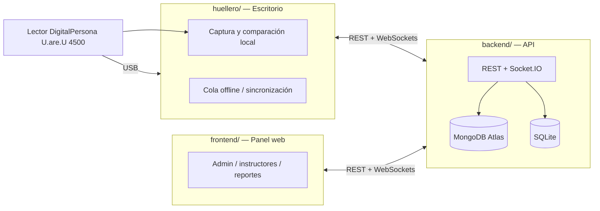

# Asista — Sistema de Asistencia Biométrica (SENA)

**Asista** (antes "Huellero" / "Huellero SENA") es un sistema de control de asistencia por huella dactilar para el SENA. Los aprendices marcan su ingreso en un lector **DigitalPersona U.are.U 4500** dentro del aula y la asistencia queda disponible en tiempo real para instructores y administradores.

> El nombre interno `huellero` se mantiene en carpetas (`huellero/`) y en el identificador de la app de escritorio (`appId`). El nombre comercial del producto es **Asista**.

---

## Arquitectura

El sistema tiene 3 componentes desacoplados:

| Componente | Descripción |
| :--- | :--- |
| **`huellero/`** | App de escritorio (Electron + Vue 3) que se ejecuta en el computador del aula, conectado físicamente al lector DigitalPersona U.are.U 4500. Hace la captura y comparación biométrica en el cliente usando `koffi` (FFI) y las DLLs nativas de DigitalPersona. |
| **`backend/`** | API REST y servidor de tiempo real (Node.js + Express + Socket.IO). Persiste en **MongoDB Atlas** y genera respaldos en **SQLite**. |
| **`frontend/`** | Panel web (Vue 3 + Quasar + Vite) para administradores e instructores: gestión de fichas, aprendices, reportes, dispositivos y monitoreo en vivo. |



El hardware biométrico y sus DLLs viven únicamente en `huellero/`, de modo que el backend y el frontend no dependen de drivers de Windows.

---

## Funciones principales

- Captura y comparación biométrica local (identificación 1:N) contra las plantillas de la ficha activa.
- Modo sin conexión: las asistencias se guardan localmente y se sincronizan automáticamente cuando vuelve la conexión (idempotente por `uuid`).
- Una asistencia por aprendiz, por ficha y por día, calculada en hora de Colombia (`America/Bogota`).
- Enrolamiento de huellas (con detección de huella duplicada y de dedo repetido).
- Registro y aprobación de equipos (dispositivos) por parte del administrador.
- Activación y cierre de clase por el instructor, con descarga de plantillas de la ficha.
- Consentimiento de tratamiento de datos personales (Habeas Data, Ley 1581 de 2012).
- Gestión de fichas, instructores, aprendices, excusas y días festivos.
- Reportes y seguimiento de inasistencias en el panel web.
- Roles: Administrador, Instructor (líder / de apoyo) y portal del aprendiz.
- Acceso de instructores: se crean con una contraseña inicial igual a su número de documento, escrito solo con números (sin puntos ni espacios); pueden cambiarla desde su Perfil. El número de documento debe registrarse sin puntos ni espacios y tener al menos 6 caracteres para poder generar la contraseña inicial.

---

## Requisitos y puesta en marcha para desarrollo

### Requisitos

- **Node.js 22** (los Dockerfiles usan `node:22-bookworm-slim` / `node:22-alpine`; no hay `.nvmrc` ni campo `engines`).
- npm.
- Para la app de escritorio: Windows 10/11 (64 bits) y lector U.are.U 4500. El driver, el SDK y el VC++ se instalan manualmente en desarrollo (ver [GUIA_INSTALACION.md](./GUIA_INSTALACION.md)).
- En una PC nueva, `setup_huellas.bat` (raíz) instala las dependencias de `backend`, `frontend` y `huellero` y verifica los componentes nativos (DLLs, koffi, SQLite).

### Comandos (tomados de cada `package.json`)

**Raíz (monorepo, workspaces `backend` + `frontend`):**

```bash
npm run dev            # backend + frontend en paralelo (concurrently)
npm run dev:backend    # solo backend  (node --watch index.js)
npm run dev:frontend   # solo frontend (vite)
npm run build:frontend # compila el frontend
npm run build:prod     # compila frontend y copia dist a backend/public/
```

**`backend/`:**

```bash
npm run dev    # node --watch index.js
npm start      # node index.js
```

**`frontend/`:**

```bash
npm run dev      # vite
npm run build    # vite build
npm run preview  # vite preview
```

**`huellero/`** (no es workspace; se instala aparte):

```bash
npm install
npm run dev         # electron-vite dev
npm run build       # electron-vite build
npm run dist        # genera el instalador (ver más abajo)
```

> `huellero/` no forma parte de los workspaces de la raíz, así que sus dependencias se instalan con `npm install` dentro de `huellero/`.

### Variables de entorno

El backend lee sus variables desde `backend/.env` (el repositorio **no** incluye un `.env.example`; crea el archivo manualmente). Nombres de variables usadas por el código:

| Variable | Descripción |
| :--- | :--- |
| `PORT` | Puerto HTTP del backend (por defecto 3000). |
| `MONGODB_URI` | Cadena de conexión a MongoDB Atlas. |
| `JWT_SECRET` | Clave para firmar los tokens JWT. |
| `JWT_EXPIRES_IN` | Vigencia de los tokens (por defecto 8h). |
| `GMAIL_USER` | Correo usado para el envío de notificaciones. |
| `GMAIL_PASS` | Contraseña de aplicación de ese correo. |
| `TZ` | Zona horaria (por defecto `America/Bogota`). |
| `SOFIA_ENCRYPTION_KEY` | Clave maestra del cifrado AES-256-GCM de credenciales Sofia Plus. |
| `CRON_SCHEDULE` | Programación del cron de exportación SQLite. |
| `CRON_TIMEZONE` | Zona horaria de los cron. |
| `ENABLE_SOFIA_SYNC` | Habilita la sincronización con Sofia Plus. |
| `CRON_SOFIA_SCHEDULE` | Programación de la sincronización Sofia Plus. |

Variables opcionales de la app de escritorio (`huellero/`):

| Variable | Descripción |
| :--- | :--- |
| `HUELLERO_BACKEND_URL` | URL del backend a la que se conecta la app. |
| `HUELLERO_WS_URL` | URL WebSocket del backend. |
| `BIOMETRIC_MATCH_THRESHOLD` | Umbral de coincidencia biométrica. |

---

## Instalación para usuarios

Para instalar la app de escritorio en un aula (instalador `.exe`, drivers, activación del equipo y uso diario), consulta la **Parte A** de [GUIA_INSTALACION.md](./GUIA_INSTALACION.md).

---

## Generar el instalador

```bash
cd huellero
npm run dist
```

Genera `huellero/release-app/Asista-Setup-<versión>.exe`. El instalador (NSIS, `huellero/build/installer.nsh`) incluye e instala en silencio, si aún no están presentes:

- Driver del lector U.are.U 4500.
- SDK U.are.U.
- Microsoft Visual C++ Redistributable (x64).

El instalador no está firmado digitalmente, por lo que Windows SmartScreen puede mostrar *"Windows protegió su PC"*: pulsa **"Más información"** → **"Ejecutar de todas formas"** (ver [GUIA_INSTALACION.md](./GUIA_INSTALACION.md)).

El workflow `.github/workflows/release.yml` genera y publica el instalador en GitHub Releases: se dispara con tags que empiezan por `v` o manualmente (`workflow_dispatch`). **Advertencia:** mientras el repositorio sea público, ese release incluye el SDK de DigitalPersona; no subas tags ni lo ejecutes manualmente sin revisarlo antes.

---

## Dónde guarda datos la app

- En desarrollo: `huellero/data/` (carpeta ignorada por Git).
- En la app instalada: `%APPDATA%\huellero` (configuración y datos locales).

No borres esa carpeta si hay asistencias pendientes de sincronizar.

---

## Estados de la barra superior (Kiosko)

Textos y condiciones según `huellero/src/renderer/src/views/KioskoView.vue`:

| Estado | Texto | Condición |
| :--- | :--- | :--- |
| En línea | `En línea` | Conexión lista (`listo`). |
| Sin internet | `Sin internet. Las asistencias se guardan en este equipo y se enviarán al reconectar.` | Sin conexión a internet (`!navigator.onLine`). |
| Deshabilitado | `Este equipo fue deshabilitado por el administrador.` | Rechazo con código `DEVICE_DISABLED`. |
| Pendiente | `Equipo registrado. Esperando aprobación del administrador.` | Rechazo con código `PENDING_APPROVAL`. |
| Error servidor | `El servidor tuvo un problema al verificar este equipo (puede ser la base de datos). Reintentando…` | Rechazo con código `INTERNAL_ERROR`. |
| Rechazo genérico | Mensaje del rechazo. | Cualquier otro rechazo del servidor. |
| Reintentando | `Reintentando…` | Conectado pero aún no listo. |
| Sin conexión | `Sin conexión con el servidor. Reintentando… (puede tardar si estaba inactivo)` | Sin conexión al servidor. |

Indicadores adicionales de la barra:

| Indicador | Texto | Condición |
| :--- | :--- | :--- |
| Clase activa | `Ficha <código>` | Hay una clase activa. |
| Lector no detectado | `Lector de huellas no detectado. Revisa que esté conectado por USB.` | Lector en estado `no-detectado`. |
| Error de lector | `Error al iniciar el lector de huellas (driver o SDK). Reinstala Asista o revisa el driver.` | Lector en estado `error`. |
| Pendientes | `N asistencias pendientes por sincronizar` | Hay asistencias sin sincronizar. |
| Sin identidad | `Equipo no identificado. Reintentando…` | El dispositivo aún no está registrado. |

---

## Despliegue

El repositorio incluye tres configuraciones de despliegue:

- **Producción (Docker Compose):** `docker-compose.yml` levanta `backend` (puerto 3001, construye `backend/Dockerfile`) y `frontend` (Nginx, puerto 80, construye `frontend/Dockerfile`). El backend lee variables desde `./backend/.env`.
  ```bash
  docker compose up -d
  ```

- **Servicio único (Render):** el `Dockerfile` de la raíz es multi-stage: compila el frontend y sirve el `dist` desde el propio backend como SPA. Es el usado para el despliegue en Render.com.
  ```bash
  docker build -t asista .
  ```

- **Desarrollo (Docker Compose):** `docker-compose.dev.yml` monta volúmenes en vivo (backend en 3001 con `Dockerfile.dev`, frontend en 5173 con `Dockerfile.dev`).
  ```bash
  docker compose -f docker-compose.dev.yml up -d
  ```

Para despliegue local sin Docker, usa los comandos de desarrollo de cada paquete (ver sección de requisitos).

---

## Estructura del repositorio

```text
HuelleroActualizado/
├── backend/               # API REST + WebSockets (Node.js + Express + Socket.IO)
│   ├── controllers/       # Lógica de los endpoints
│   ├── models/            # Modelos Mongoose
│   ├── routes/            # Enrutadores REST (/api/...)
│   ├── services/          # Socket.IO, cron, SQLite, correo, cifrado
│   ├── middlewares/       # Autenticación JWT, validación, rate limiting
│   ├── data/              # SQLite exportado por docente (ignorado por Git)
│   └── Dockerfile(.dev)
├── frontend/              # Panel web (Vue 3 + Quasar + Vite)
│   ├── src/               # views, components, services, router, ...
│   ├── nginx.conf         # Reverse proxy /api y /socket.io
│   └── Dockerfile(.dev)
├── huellero/              # App de escritorio (Electron + Vue 3 + koffi)
│   ├── src/main/          # Captura, motor biométrico, WebSocket, offline
│   ├── src/renderer/      # UI del kiosco
│   ├── dll/               # DLLs nativas DigitalPersona
│   └── build/             # Instalador NSIS, driver, SDK, VC++, icono
├── docs/                  # Documentación técnica y del proyecto
├── scripts/               # copy-dist.js (build de producción)
├── Dockerfile             # Despliegue single-service (Render)
├── docker-compose.yml     # Producción (backend + frontend)
├── docker-compose.dev.yml # Desarrollo
└── package.json           # Scripts del monorepo (workspaces backend/frontend)
```

---

## Documentación adicional

- [GUIA_INSTALACION.md](./GUIA_INSTALACION.md) — instalación de hardware/drivers y de la app para usuarios y desarrolladores.
- [TROUBLESHOOTING.md](./TROUBLESHOOTING.md) — registro de incidencias y correcciones.
- [DESIGN.md](./DESIGN.md) — especificación de diseño e identidad visual.
- [CONSOLIDADO_CAMBIOS_Y_BUGS.md](./CONSOLIDADO_CAMBIOS_Y_BUGS.md) — consolidado técnico de arquitectura, cambios y bugs.
- [docs/PRD.md](./docs/PRD.md) — documento de requisitos del producto.
- [docs/SETUP.md](./docs/SETUP.md) — instalación de Asista en una PC nueva (modo desarrollo).
- [docs/EULA SDK.rtf](./docs/EULA%20SDK.rtf) — licencia del SDK de DigitalPersona.

---

## Licencia y uso

- El SDK de DigitalPersona se usa bajo su EULA (ver `docs/EULA SDK.rtf`).
- Uso **interno** del SENA.
- El repositorio debe mantenerse **privado**.
- No redistribuir el instalador ni el SDK fuera de la institución sin autorización.
