# MANUAL DE USUARIO — SISTEMA ASISTA
## Sistema de Control Biométrico de Asistencia y Gestión de Inasistencias en Ambiente de Formación

---

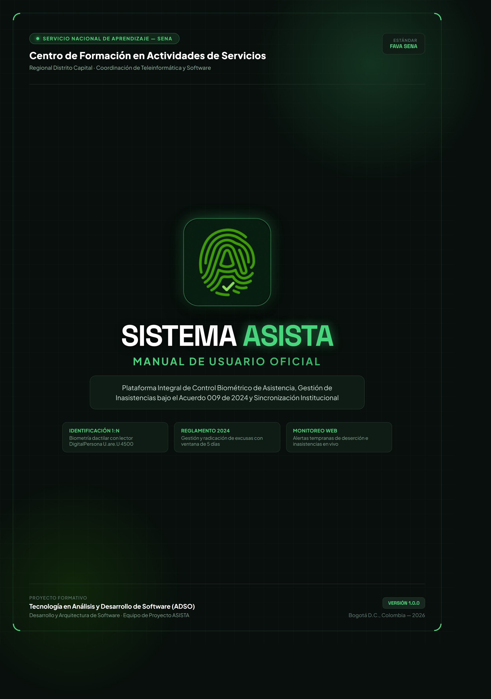

```
========================================================================================
SERVICIO NACIONAL DE APRENDIZAJE — SENA
REGIONAL DISTRITO CAPITAL
CENTRO DE FORMACIÓN EN ACTIVIDADES DE SERVICIOS / TELEINFORMÁTICA
PROGRAMA: TECNOLOGÍA EN ANÁLISIS Y DESARROLLO DE SOFTWARE (ADSO)

SISTEMA ASISTA — VERSIÓN 1.0.0
MANUAL DE USUARIO OFICIAL (NORMA SENA FAVA)
Bogotá D.C., Colombia — 2026
========================================================================================
```

---

## CONTROL DEL DOCUMENTO

| Campo | Detalle Institucional |
| :--- | :--- |
| **Nombre del Documento** | Manual de Usuario Oficial — Sistema ASISTA |
| **Código del Proyecto** | ASISTA (Asistencia Inteligente y Sincronizada para Formación y Aprendizaje) |
| **Versión** | 1.0.0 |
| **Fecha de Publicación** | Octubre de 2026 |
| **Autores / Equipo Desarrollador** | Juan Camilo Viviescas y Equipo de Desarrollo ADSO |
| **Programa de Formación** | Análisis y Desarrollo de Software (ADSO) |
| **Centro de Formación** | Centro de Formación en Actividades de Servicios — Regional Distrito Capital |
| **Destinatarios** | Instructores, Aprendices, Coordinadores Académicos y Administradores del Sistema |
| **Normativa Legal Aplicada** | Acuerdo 009 de 2024 (Reglamento del Aprendiz SENA) y Ley 1581 de 2012 (Habeas Data) |

---

## TABLA DE CONTENIDO

1. [Capítulo 1: Información General del Sistema](#capítulo-1-información-general-del-sistema)
   - 1.1 Alcance del Sistema
   - 1.2 Requisitos de Conocimiento del Usuario
   - 1.3 Requerimientos de Hardware y Software
   - 1.4 Política de Seguridad y Tratamiento de Datos (Habeas Data)
   - 1.5 Convenciones y Simbología
   - 1.6 Mapa de Navegación del Sistema
2. [Capítulo 2: Módulos de Autenticación y Acceso](#capítulo-2-módulos-de-autenticación-y-acceso)
   - 2.1 Acceso Personal (Instructores y Administradores)
   - 2.2 Consulta de Aprendiz (Ingreso por Documento)
   - 2.3 Recuperación de Contraseña
3. [Capítulo 3: Portal del Aprendiz](#capítulo-3-portal-del-aprendiz)
   - 3.1 Consulta de Inasistencias y Horas Acumuladas
   - 3.2 Radicación de Excusas Justificadas (Acuerdo 009 de 2024)
4. [Capítulo 4: Portal del Instructor](#capítulo-4-portal-del-instructor)
   - 4.1 Panel de Mis Fichas / Grupos Asignados
   - 4.2 Toma de Asistencia Manual, Marcación de Novedades y Sincronización Inmediata
   - 4.3 Gestión y Aprobación de Excusas Radicadas
5. [Capítulo 5: Módulos de Administración del Sistema](#capítulo-5-módulos-de-administración-del-sistema)
   - 5.1 Perfil y Métricas del Administrador
   - 5.2 Gestión de Instructores
   - 5.3 Gestión de Aprendices
   - 5.4 Gestión de Fichas y Asignación de Docentes
   - 5.5 Gestión y Aprobación de Dispositivos (Huelleros en Aula)
   - 5.6 Carga Masiva e Importación de Usuarios (Excel / CSV)
   - 5.7 Generación de Reportes y Descargas
   - 5.8 Seguimiento de Inasistencias y Alerta Temprana de Deserción
   - 5.9 Gestión de Días Inhabilitados y Festivos
6. [Capítulo 6: Aplicación de Aula (Kiosco Huellero de Escritorio) y Automatización RPA](#capítulo-6-aplicación-de-aula-kiosco-huellero-de-escritorio)
   - 6.1 Instalación y Ejecución de ASISTA Desktop
   - 6.2 Inicio de Clase por el Docente
   - 6.3 Marcación Biométrica Dactilar (1:N)
   - 6.4 Tiempos de Asistencia, Retardos y Auto-Cierre
   - 6.5 Módulo de Enrolamiento de Huellas Dactilares
   - 6.6 Ciclo Legal de Excusas (Acuerdo 009 de 2024) y Sincronización Automática con SENA Sofia Plus (Robot RPA)
7. [Capítulo 7: Soporte Técnico, Mesa de Ayuda y Errores](#capítulo-7-soporte-técnico-mesa-de-ayuda-y-errores)
   - 7.1 Directorio de Mesa de Ayuda
   - 7.2 Protocolo de Escalamiento a Tres Niveles
   - 7.3 Catálogo de Errores Frecuentes y Soluciones

---

# Capítulo 1: Información General del Sistema

### 1.1 Alcance del Sistema
El sistema **ASISTA** ha sido concebido para modernizar, automatizar y asegurar el registro de asistencia de los aprendices en los ambientes de formación del SENA mediante identificación biométrica dactilar (1:N), integrando una arquitectura híbrida compuesta por:
* **Una aplicación de aula (Kiosco Electron)** conectada al lector biométrico DigitalPersona U.are.U 4500 para captura y validación instantánea.
* **Una plataforma web centralizada** para instructores, coordinadores y administradores con seguimiento en tiempo real, radicación de excusas según el **Acuerdo 009 de 2024** y sincronización hacia Sofía Plus.

### 1.2 Requisitos de Conocimiento del Usuario
Para la operación eficiente del sistema se requiere:
* Conocimientos básicos en manejo del sistema operativo Microsoft Windows (manejo de mouse, teclado y ventanas).
* Habilidades fundamentales de navegación en aplicaciones web (uso de navegadores, formularios, descarga de reportes).
* Comprensión básica de los lineamientos del Reglamento del Aprendiz SENA relativos a faltas justificadas e injustificadas.

### 1.3 Requerimientos de Hardware y Software

#### Estación de Aula (Kiosco Biométrico)
* **Procesador:** Intel Core i3 / AMD Ryzen 3 o superior (mínimo 2.0 GHz).
* **Memoria RAM:** 4 GB mínimo (8 GB recomendado).
* **Almacenamiento:** 500 MB libres en disco de estado sólido o disco duro.
* **Lector Biométrico:** DigitalPersona U.are.U 4500 (óptico, conexión USB 2.0/3.0).
* **Sistema Operativo:** Windows 10 o Windows 11 de 64 bits.
* **Componentes Base:** DigitalPersona RTE (Run Time Environment) y Visual C++ Redistributable 2015-2022.

#### Estación Cliente Web (Instructores / Aprendices / Administradores)
* **Navegador Web:** Google Chrome v95+, Microsoft Edge v95+ o Mozilla Firefox v95+.
* **Conectividad:** Conexión de red local o acceso a Internet (mínimo 5 Mbps).

### 1.4 Política de Seguridad y Tratamiento de Datos (Habeas Data)
De estricta conformidad con la **Ley Estatutaria 1581 de 2012** de la República de Colombia (Régimen General de Protección de Datos Personales):
* **No almacenamiento de imágenes dactilares:** El sistema ASISTA **no almacena imágenes, fotos ni representaciones gráficas de las huellas dactilares**. Al colocar el dedo en el prisma óptico, el SDK extrae únicamente puntos característicos matemáticos (minucias) compilados en una plantilla binaria cifrada (FMD - *Fingerprint Minutiae Data*). Dicho vector es unidireccional y técnicamente irreversible.
* **Consentimiento Informado:** Todo aprendiz debe autorizar el registro biométrico previo al enrolamiento.
* **Cifrado de Credenciales:** Todas las contraseñas están protegidas mediante algoritmo criptográfico **bcrypt** con factor de coste 10.
* **Manejo de Sesiones:** El acceso web está restringido mediante tokens seguros JWT (*JSON Web Tokens*) con tiempo de expiración programado.

### 1.5 Convenciones y Simbología
* 📌 **Nota:** Aclaración técnica relevante sobre el comportamiento del sistema.
* ⚠️ **Atención:** Acción que requiere validación previa para evitar bloqueos o registros no deseados.
* 🔒 **Seguridad:** Advertencia sobre confidencialidad de credenciales o protección de datos biométricos.
* 🟢 **Marcación Verde:** Aprendiz presente a tiempo (dentro del tiempo de gracia de 10 minutos).
* 🟡 **Marcación Amarilla:** Retardo registrado (1 hora o 2 horas según franja).
* 🔴 **Marcación Roja:** Huella no reconocida o aprendiz no matriculado en la ficha activa.

### 1.6 Mapa de Navegación del Sistema

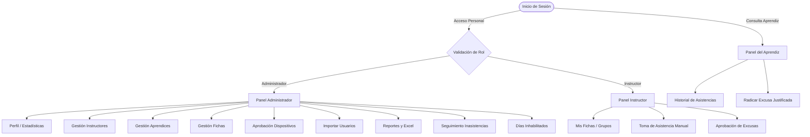

---

# Capítulo 2: Módulos de Autenticación y Acceso

### 2.1 Acceso Personal (Instructores y Administradores)
Permite a los instructores y administradores identificarse con su correo institucional registrado y contraseña personal.

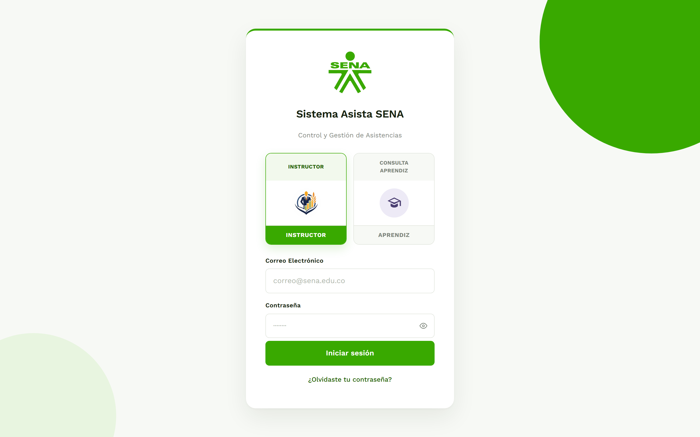  
*Figura 2.1: Pantalla de Autenticación de Personal (Instructores y Administradores)*

#### Elementos de la Interfaz

| No. | Elemento / Campo | Descripción | Detalle y Validación |
| :---: | :--- | :--- | :--- |
| **1** | Selector de Carnet | Botón superior para conmutar entre perfil Instructor y Consulta Aprendiz. | Permite alternar la modalidad de formulario. |
| **2** | Correo Electrónico | Campo de texto para ingresar el correo institucional registrado. | Obligatorio. Formato de correo válido (`usuario@sena.edu.co` o correo personal registrado). |
| **3** | Contraseña | Campo de texto enmascarado para la clave de acceso. | Obligatorio. Mínimo 8 caracteres. Sensible a mayúsculas y minúsculas. |
| **4** | Conmutador de Visibilidad | Icono en forma de ojo para mostrar u ocultar la clave digitada. | Opcional. Permite verificar visualmente la clave ingresada. |
| **5** | Botón "Iniciar Sesión" | Botón principal de acción para enviar credenciales al servidor. | Valida credenciales contra la base de datos y genera el token de sesión. |
| **6** | Enlace "¿Olvidaste tu contraseña?" | Vínculo de recuperación de acceso institucional. | Redirige al flujo de restablecimiento de contraseña vía código de verificación. |

#### Procedimiento de Ingreso
1. **Paso 1:** Abra su navegador web e ingrese a la dirección URL oficial: `https://asista.onrender.com`.
2. **Paso 2:** Verifique que el carnet seleccionado sea **"Instructor"** (Elemento 1).
3. **Paso 3:** Digite su correo institucional en el campo **Correo Electrónico** (Elemento 2).
4. **Paso 4:** Digite su contraseña en el campo **Contraseña** (Elemento 3).
5. **Paso 5:** Haga clic en el botón **"Iniciar Sesión"** (Elemento 5). El sistema cargará el entorno de trabajo según su perfil.

---

### 2.2 Consulta de Aprendiz (Ingreso por Documento)
Modalidad simplificada de consulta para aprendices. No requiere contraseña compleja, garantizando acceso directo a sus registros y radicación de excusas.

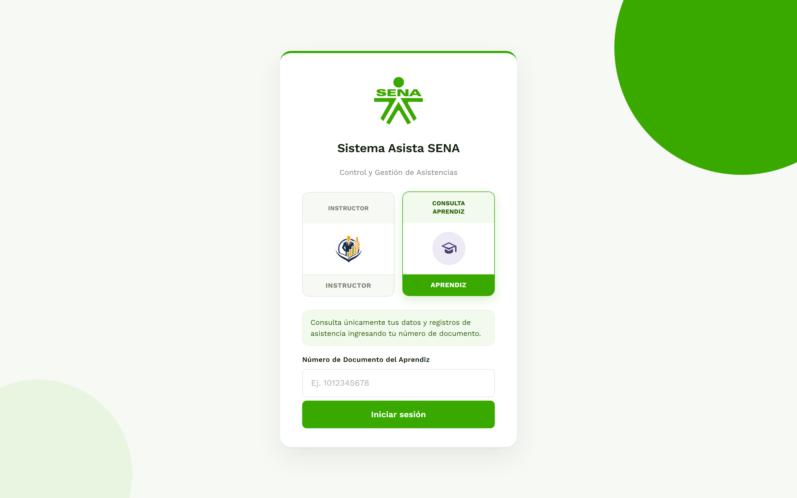  
*Figura 2.2: Pantalla de Consulta Exclusiva para Aprendices*

#### Elementos de la Interfaz

| No. | Elemento / Campo | Descripción | Detalle y Validación |
| :---: | :--- | :--- | :--- |
| **1** | Selector "Consulta Aprendiz" | Carnet activo que habilita el formulario rápido de aprendices. | Estado visualmente destacado en verde institucional. |
| **2** | Número de Documento | Campo numérico para digitar la identificación del aprendiz. | Obligatorio. Numérico, sin puntos, espacios ni guiones. |
| **3** | Botón "Iniciar Sesión" | Botón de consulta que autentica al estudiante por su documento. | Verifica el estado del aprendiz y abre su panel privado. |

#### Procedimiento de Consulta
1. **Paso 1:** En la pantalla de inicio, haga clic sobre el carnet **"Consulta Aprendiz"** (Elemento 1).
2. **Paso 2:** Digite su número de cédula de ciudadanía, tarjeta de identidad o PPT en el campo **Número de Documento del Aprendiz** (Elemento 2).
3. **Paso 3:** Presione la tecla **Enter** o haga clic en **"Iniciar Sesión"** (Elemento 3).

---

### 2.3 Recuperación de Contraseña
Permite a los usuarios restablecer su clave de acceso de manera autónoma cuando la han olvidado.

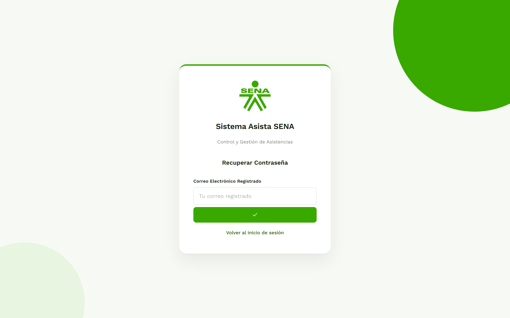  
*Figura 2.3: Ventana de Recuperación de Contraseña*

#### Elementos de la Interfaz

| No. | Elemento / Campo | Descripción | Detalle y Validación |
| :---: | :--- | :--- | :--- |
| **1** | Correo Registrado | Campo de texto para indicar la cuenta de correo asociada. | Debe coincidir con el correo asignado en la plataforma. |
| **2** | Botón "Enviar Código" | Acción que despacha un código aleatorio al buzón del usuario. | Código seguro temporal con expiración de 15 minutos. |
| **3** | Código de Verificación | Campo de 6 dígitos numéricos recibidos en el correo. | Obligatorio para habilitar el cambio de clave. |
| **4** | Nueva Contraseña | Campo para establecer la nueva clave personal. | Mínimo 8 caracteres. Se recomienda incluir letras y números. |

---

# Capítulo 3: Portal del Aprendiz

### 3.1 Consulta de Inasistencias y Horas Acumuladas
El aprendiz cuenta con un tablero en tiempo real donde puede supervisar su porcentaje de asistencia, verificar sus horas acumuladas de falta y comprobar su estado formativo.

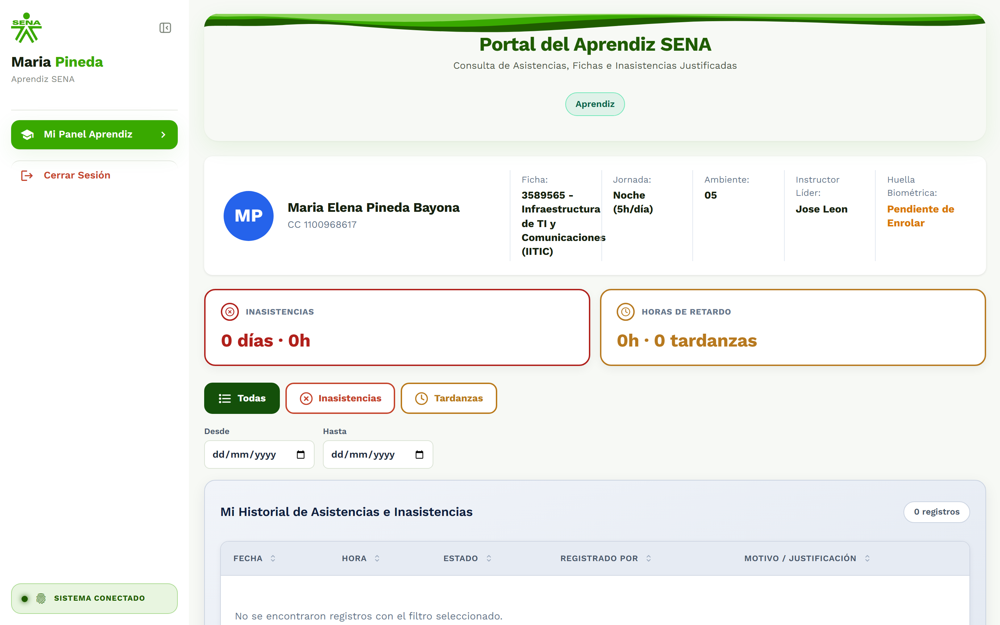  
*Figura 3.1: Tablero Principal del Aprendiz en Producción*

#### Elementos del Tablero
* **Resumen de Horas:** Muestra de forma inmediata las horas totales de inasistencia registradas en el período.
* **Porcentaje de Inasistencia:** Indicador visual que previene deserciones antes de superar el límite crítico (según el Acuerdo 009 de 2024).
* **Historial Detallado por Fecha:** Tabla cronológica con fecha, ficha, estado (Presente, Retardo, Inasistencia) y condición de justificación.

### 3.2 Radicación de Excusas Justificadas (Acuerdo 009 de 2024)
Conforme a la normativa SENA vigente:
1. El aprendiz dispone de un término perentorio de **cinco (5) días hábiles** contados a partir del día siguiente a la inasistencia para radicar su justificación.
2. Al pulsar el botón **"Radicar Excusa"**, el aprendiz debe:
   * Seleccionar la fecha y clase correspondiente a la inasistencia.
   * Seleccionar el motivo legal (Incapacidad médica EPS/SURA, calamidad doméstica demostrable o diligencia judicial/laboral).
   * Adjuntar el soporte en archivo digital (PDF o imagen escaneada legible).
   * Redactar una breve observación aclaratoria.
3. El sistema registra la radicación en estado **"Pendiente"** y notifica al instructor para su revisión técnica.

---

# Capítulo 4: Portal del Instructor

### 4.1 Panel de Mis Fichas / Grupos Asignados
Permite a cada docente consultar las fichas formativas bajo su responsabilidad, visualizar la programación de jornadas y supervisar el quórum de aprendices.

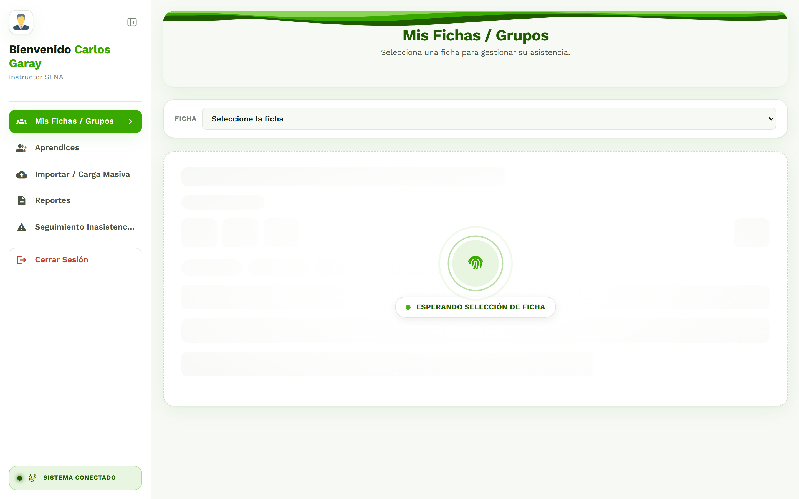  
*Figura 4.1: Panel de Fichas y Toma de Asistencia del Instructor en Producción*

### 4.2 Toma de Asistencia Manual, Marcación de Novedades y Sincronización Inmediata
El panel del instructor permite gestionar la asistencia en tiempo real con sincronización atómica hacia la base de datos en la nube (MongoDB Atlas):

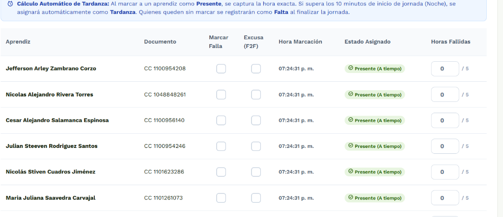  
*Figura 4.2: Marcación Inmediata de Novedades y Cálculo Automático de Tardanza en Producción*

1. **Cálculo Automático de Tardanza:** Al marcar a un aprendiz como *Presente*, se captura la hora exacta de marcación. Si supera los 10 minutos de inicio de jornada (Noche: 5 horas totales, Diurna: 6 horas totales), el sistema asigna automáticamente el estado **Tardanza** con las horas de retraso correspondientes. Quienes queden sin marcar se registrarán como **Falta** al finalizar la jornada.
2. **Marcar Falla Directa:** La casilla «Marcar Falla» permite radicar la inasistencia completa de forma instantánea. Al hacer clic, se activa el indicador de sincronización en caliente (`●` *Guardando…* → `✓` *Guardado*) sin requerir presionar ningún botón de guardar general. Si se desmarca, el sistema revierte el registro y restablece al aprendiz como *Presente*.
3. **Excusa Presencial (F2F - Face to Face):** Si el aprendiz presenta una justificación física directamente en el aula, la casilla «Excusa (F2F)» abre un modal para ingresar la observación o motivo. El sistema registra inmediatamente la novedad como **Excusada** en MongoDB Atlas y genera el documento de excusa en estado **Aprobada**.
4. **Horas Fallidas Editables:** El campo numérico de horas (ej. `0 / 5`) cuenta con un temporizador inteligente (*debounce* de 800 ms): si el aprendiz asiste parcialmente (por ejemplo 2 horas de retraso), el docente ajusta el número y el sistema persiste la tardanza exacta de forma inmediata.
5. **Modo Offline Resiliente:** Si se pierde la conectividad a internet en el aula, las novedades se almacenan localmente en la cola offline del navegador (`draftStore`) y se sincronizan de forma autónoma con la nube tan pronto se restablece el enlace.

### 4.3 Gestión y Aprobación de Excusas Radicadas
El instructor evalúa las solicitudes radicadas por los aprendices de sus fichas:
* **Aprobación:** Si el soporte médico o legal es válido, el instructor pulsa **"Aprobar"**. El sistema descuenta de inmediato las horas no justificadas del aprendiz en el consolidado.
* **Rechazo:** Si el documento no es idóneo o fue presentado fuera del plazo legal de 5 días hábiles, se selecciona **"Rechazar"** incorporando el motivo de rechazo reglamentario.

---

# Capítulo 5: Módulos de Administración del Sistema

### 5.1 Perfil y Métricas del Administrador
Visualización ejecutiva de la salud del sistema: número de fichas activas, instructores vinculados, total de aprendices y estado de los servicios.

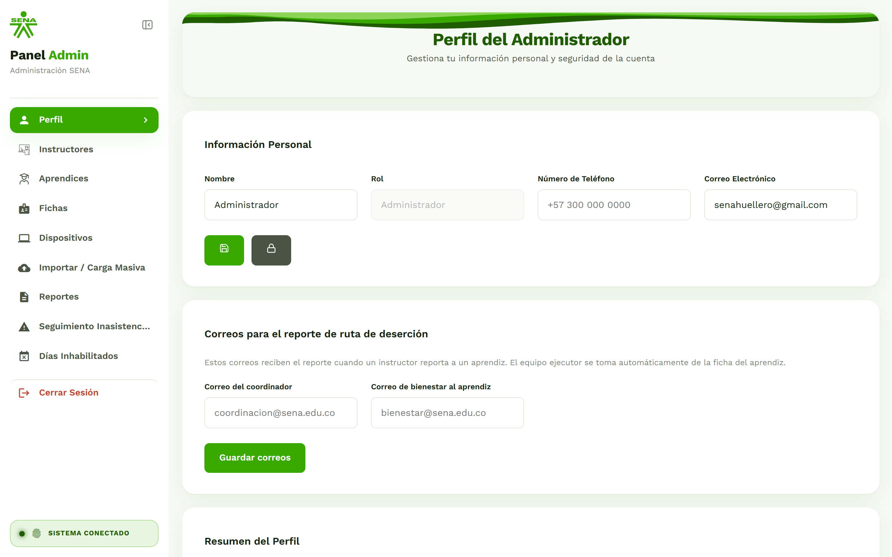  
*Figura 5.1: Panel Central y Perfil del Administrador*

---

### 5.2 Gestión de Instructores
Módulo integral para crear, editar, asignar rol de instructor líder y gestionar las cuentas de acceso del personal docente.

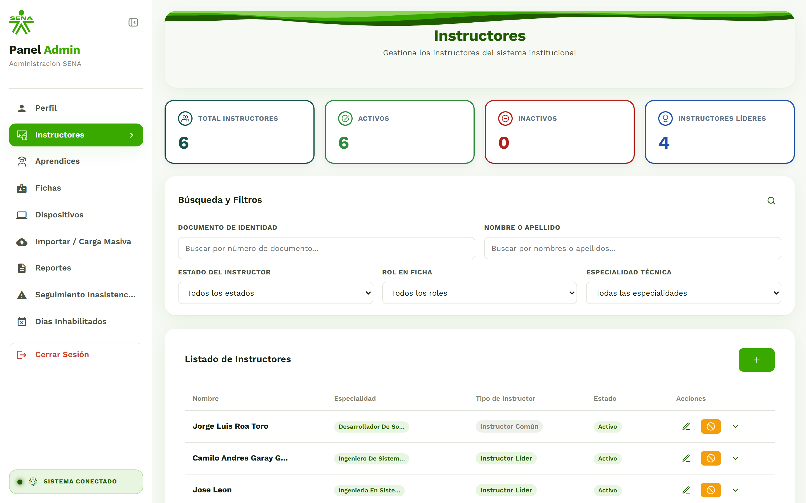  
*Figura 5.2: Catálogo de Instructores en Producción*

#### Procedimiento de Registro de Instructor
1. Haga clic en el botón superior **"Nuevo Instructor"**.
2. Digite los nombres, apellidos, tipo y número de documento.
3. Ingrese el correo institucional `@sena.edu.co`.
4. Defina si el docente ejercerá como **Instructor Líder de Ficha**.
5. Guarde los cambios. La contraseña inicial corresponderá a su número de documento sin puntos.

---

### 5.3 Gestión de Aprendices
Directorio centralizado con información de identificación, correo electrónico, estado académico y ficha asignada.

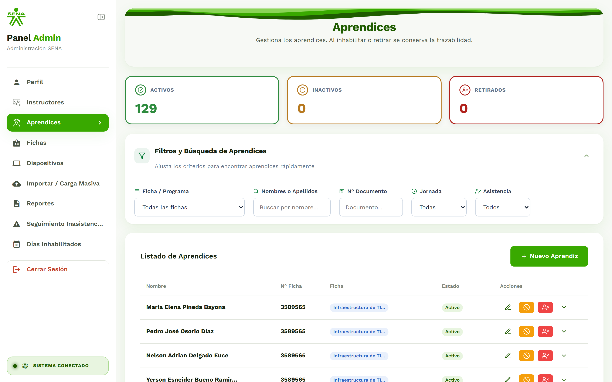  
*Figura 5.3: Directorio de Aprendices Registrados en Producción*

---

### 5.4 Gestión de Fichas y Asignación de Docentes
Administración de los programas de formación, código de ficha, jornada (Diurna / Nocturna / Mixta) y vinculación de los instructores encargados.

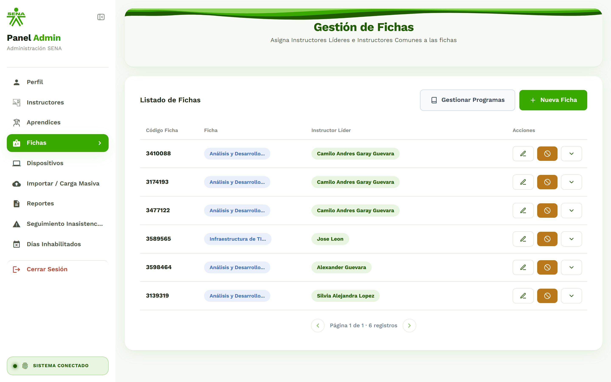  
*Figura 5.4: Módulo de Fichas Formativas en Producción*

---

### 5.5 Gestión y Aprobación de Dispositivos (Huelleros en Aula)
Garantiza que únicamente los computadores físicos autorizados de los ambientes de formación puedan sincronizar marcaciones biométricas hacia el servidor central.

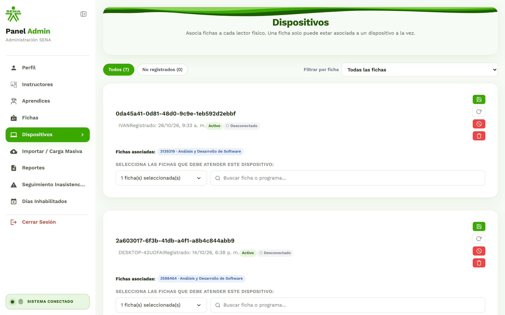  
*Figura 5.5: Control de Dispositivos de Aula Autorizados en Producción*

#### Procedimiento de Autorización de un Computador de Aula
1. Al ejecutar por primera vez la aplicación de escritorio en un computador del ambiente, este enviará una solicitud de vinculación con su identificador de hardware.
2. En la pantalla de **Dispositivos**, el administrador verá el equipo en estado **"Pendiente"**.
3. Haga clic en **"Aprobar"** y asigne un nombre descriptivo (ej. *"Ambiente 304 - Torre 1"*). El equipo quedará habilitado de forma permanente.

---

### 5.6 Carga Masiva e Importación de Usuarios (Excel / CSV)
Permite al administrador o instructor líder poblar masivamente aprendices y fichas desde las planillas descargadas de Sofía Plus.

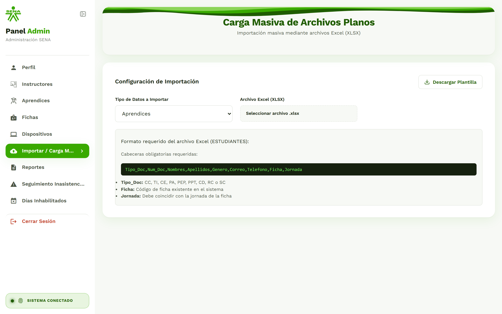  
*Figura 5.6: Asistente de Carga Masiva de Aprendices y Fichas*

---

### 5.7 Generación de Reportes y Descargas
Generación de reportes ejecutivos en formato Microsoft Excel (.xlsx) y PDF por ficha, instructor, fecha o consolidado mensual de horas.

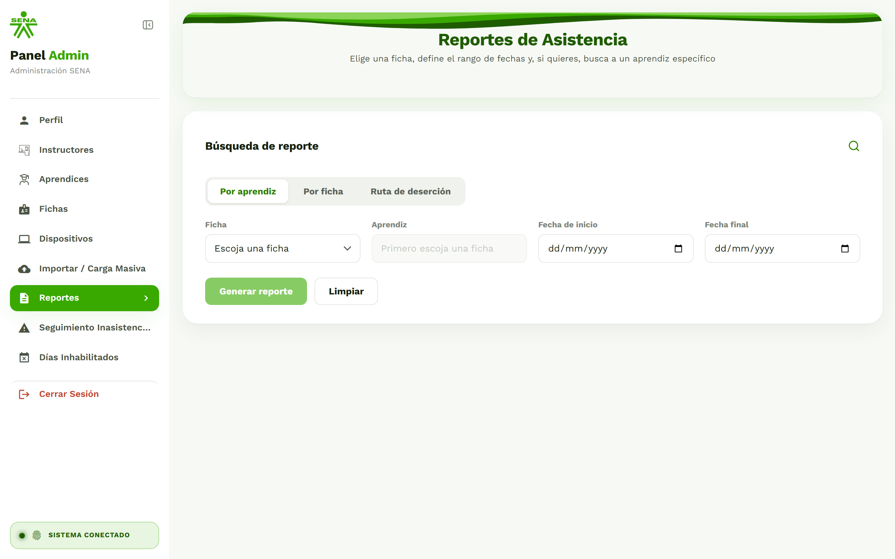  
*Figura 5.7: Generador de Reportes y Filtros Avanzados*

---

### 5.8 Seguimiento de Inasistencias y Alerta Temprana de Deserción
Tablero analítico con semaforización de aprendices en riesgo de deserción por acumulación de inasistencias injustificadas.

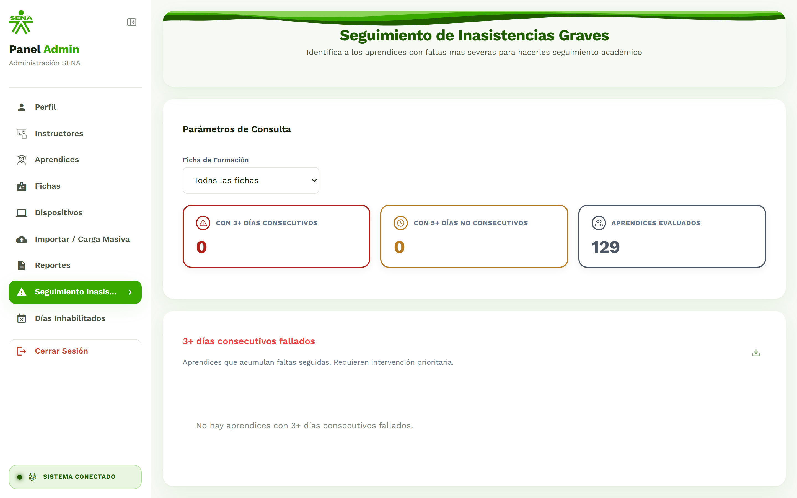  
*Figura 5.8: Módulo de Alerta Temprana y Seguimiento de Inasistencias*

* 🟢 **Verde (< 10% de inasistencias):** Desempeño normal en asistencia.
* 🟡 **Amarillo (10% - 14% de inasistencias):** Alerta preventiva; el instructor líder debe emitir llamado de atención.
* 🔴 **Rojo (>= 15% de inasistencias):** Nivel crítico; causal de deserción formativa según el Reglamento del Aprendiz.

---

### 5.9 Gestión de Días Inhabilitados y Festivos
Permite registrar en el calendario las fechas festivas, jornadas pedagógicas o suspensiones autorizadas, evitando que los procesos automáticos generen inasistencias erróneas.

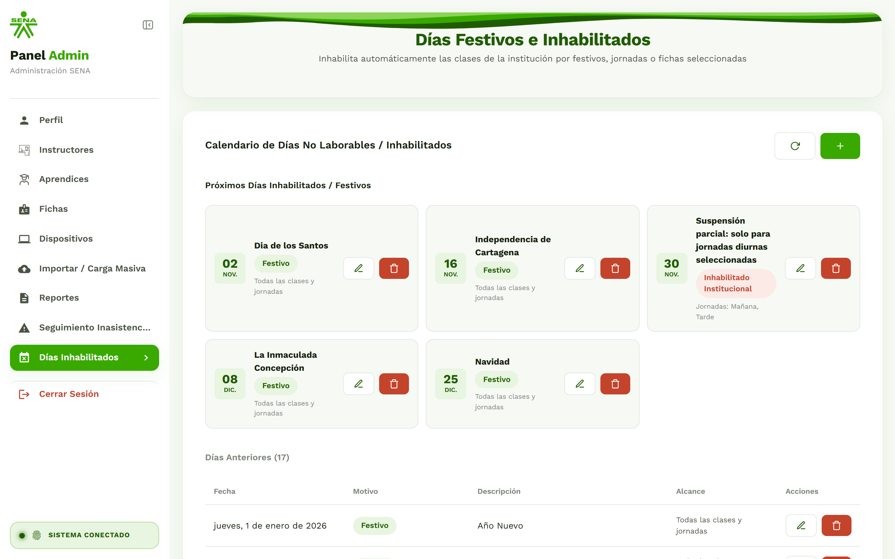  
*Figura 5.9: Calendario de Días Festivos e Inhabilitados*

---

# Capítulo 6: Aplicación de Aula (Kiosco Huellero de Escritorio)

### 6.1 Instalación y Ejecución de ASISTA Desktop
1. Descargue el instalador oficial firmado: `Asista-Setup-1.0.0.exe`.
2. Ejecute el instalador con permisos de administrador e instale el certificado institucional si se solicita.
3. Asegúrese de que el lector **DigitalPersona U.are.U 4500** se encuentre conectado en un puerto USB directo del equipo.

### 6.2 Inicio de Clase por el Docente
1. Al abrir la aplicación, el docente ingresa su documento o credencial.
2. Selecciona la ficha activa y la jornada correspondiente (Diurna o Nocturna).
3. Presiona el botón **"Iniciar Clase"**. La aplicación entra en modo Kiosco interactivo de marcación.

### 6.3 Marcación Biométrica Dactilar (1:N)
* Los aprendices se acercan al kiosco y colocan la yema de su dedo enrolado sobre el prisma de vidrio del lector.
* **Retroalimentación en pantalla:**
  * Sonido y halo verde: Aprendiz identificado a tiempo.
  * Sonido y halo amarillo: Aprendiz registrado con retardo.
  * Sonido y halo rojo: Huella no reconocida (se sugiere limpiar el sensor y volver a posicionar el dedo centrado).

### 6.4 Reglas de Tolerancia, Retardos y Auto-Cierre
* **Tiempo de Gracia:** Los primeros **10 minutos** tras la hora oficial de inicio de clase se registran como **Presente (0 horas de falta)**.
* **Retardo de 1 Hora:** Marcaciones efectuadas entre el **minuto 11 y el minuto 60** desde el inicio de clase.
* **Retardo de 2 Horas:** Marcaciones efectuadas entre el **minuto 61 y el minuto 120**.
* **Inasistencia Completa:** Aprendices que no registren huella dentro de los primeros 120 minutos.
* **Auto-Cierre Dinámico:** Al finalizar la duración oficial de la jornada (6 horas en diurna, 5 horas en nocturna), el sistema cierra la sesión de clase automáticamente y consolida el reporte final.

### 6.5 Módulo de Enrolamiento de Huellas Dactilares
Cuando un aprendiz nuevo ingresa al programa o requiere re-enrolar su huella:
1. El docente o administrador abre el asistente **"Enrolar Huella"**.
2. Selecciona al aprendiz de la lista.
3. Solicita la firma o aceptación verbal del consentimiento de tratamiento de datos personales.
4. El aprendiz coloca el dedo sobre el lector cuatro (4) veces consecutivas hasta que el indicador de calidad biométrica alcance el 100%.

### 6.6 Ciclo Legal de Excusas (Acuerdo 009 de 2024) y Sincronización Automática con SENA Sofia Plus (Robot RPA)
ASISTA cuenta con un subsistema de Automatización Robótica de Procesos (RPA) desarrollado con Playwright en Node.js y orquestado mediante **GitHub Actions**, encargado de reportar oficialmente las fallas y novedades en el portal institucional **SENA Sofia Plus**:

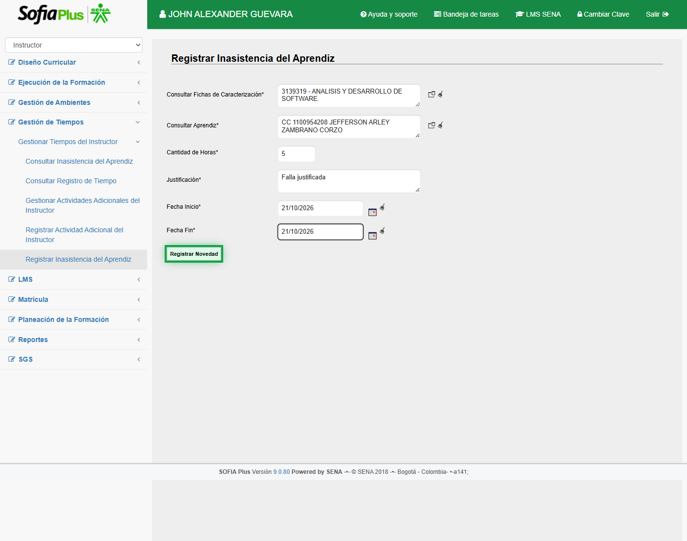  
*Figura 6.1: Diligenciamiento Oficial Autónomo en Sofia Plus por el Robot RPA para el Aprendiz CC 1100954208*

1. **Ventana Legal de 5 Días Hábiles (Acuerdo 009 de 2024):** Conforme al Reglamento del Aprendiz SENA, cuando se registra una inasistencia o tardanza, esta entra en estado inicial **`EN_ESPERA`**. Durante los 5 días hábiles siguientes (excluyendo sábados, domingos y días festivos registrados en el sistema), el aprendiz tiene derecho a radicar su excusa médica o justificación laboral.
2. **Transición Automática a Lista para Subir:** El cron nocturno evalúa a diario la antigüedad de cada novedad. Si transcurren los 5 días hábiles sin excusa aprobada, la novedad pasa automáticamente al estado **`LISTO_PARA_SUBIR`**. Si la excusa fue aprobada por el instructor, la novedad pasa a **`LISTO_PARA_SUBIR`** con la justificación y motivo redactados por el docente para que Sofia Plus registre la novedad justificada.
3. **Orquestación en la Nube con GitHub Actions:**
   * **Programación Nocturna:** Todos los sábados a las 11:00 p.m. hora Colombia (`cron: '0 4 * * 0'`), un flujo automatizado de GitHub Actions despierta una máquina virtual con 7 GB de RAM.
   * **Disparo Manual / Pruebas:** Los administradores pueden ejecutar el flujo bajo demanda desde la pestaña *Actions* de GitHub mediante el botón *Run workflow*, eligiendo entre **Modo Seguro (`dry-run`)** para simular con capturas sin guardar cambios o **Modo Real (`confirmar`)** para persistir oficialmente en Sofia Plus.
   * **Ejecución Secuencial:** El robot procesa docente por docente, abriendo una sola instancia de Chromium para evitar saturar la memoria y evadir bloqueos por rate limiting o firewall en Sofia Plus.
4. **Candado de Seguridad y Trazabilidad:** Al completar el reporte exitoso en Sofia Plus, la novedad se actualiza en MongoDB Atlas con `estadoCarga = 'SUBIDA'` y `subidoSofia = true`. En la interfaz web del instructor, la fila se bloquea con una insignia verde permanente (**Reportado Sofia Plus 🔒**), impidiendo cualquier modificación posterior no autorizada.
5. **Evidencias Fotográficas Descargables:** En cada ejecución, GitHub Actions empaqueta automáticamente todas las capturas de pantalla tomadas durante el proceso (`rpa/descargas/evidencias_inasistencias/`) y las adjunta como un artefacto `.zip` descargable durante 14 días para auditoría y control de calidad.

---

# Capítulo 7: Soporte Técnico, Mesa de Ayuda y Errores

### 7.1 Directorio de Mesa de Ayuda
Para solicitudes de soporte técnico, restablecimiento de cuentas o incidencias de conectividad:
* **Correo de Soporte Institucional:** `soporte.asista@sena.edu.co`
* **Mesa de Ayuda TIC / Tickets:** Sistema de Tickets de Mesa de Ayuda del Centro de Formación.
* **Horario de Atención:** Lunes a Viernes de 7:00 a.m. a 9:00 p.m. — Sábados de 8:00 a.m. a 1:00 p.m.

### 7.2 Protocolo de Escalamiento a Tres Niveles
* **Nivel 1 (Atención en Aula):** Instructor o Monitor de Ambiente. Asiste en la correcta postura del dedo en el sensor o registra la asistencia manual en caso de contingencia.
* **Nivel 2 (Administración del Sistema):** Administrador del Centro de Formación. Habilita nuevos computadores de aula, crea instructores y gestiona días festivos.
* **Nivel 3 (Soporte de Desarrollo e Infraestructura):** Equipo de Desarrollo ADSO y administradores de servidores. Resuelven incidentes de base de datos, APIs de sincronización y conectividad WebSocket.

### 7.3 Catálogo de Errores Frecuentes y Soluciones

| Mensaje de Error / Síntoma | Causa Probable | Solución Aplicada |
| :--- | :--- | :--- |
| **"Credenciales incorrectas"** | Contraseña o correo digitado de forma errónea; Bloq Mayús activo. | Verificar la escritura. Si el problema persiste, usar el enlace "¿Olvidaste tu contraseña?". |
| **"Dispositivo no aprobado por el administrador"** | El computador del aula es nuevo o no ha sido autorizado en la web. | Contactar al Administrador para que ingrese a la vista *Dispositivos* y presione "Aprobar". |
| **"Error DPFPDD: Lector no detectado"** | El cable USB del lector U.are.U 4500 está suelto o faltan los drivers RTE. | Reconectar el lector en otro puerto USB. Verificar que el servicio DigitalPersona esté en ejecución. |
| **"Huella no coincide / Aprendiz no encontrado"** | Dedo mal posicionado, sucio, o el aprendiz no ha sido enrolado aún. | Limpiar el prisma con paño seco. Si nunca ha enrolado, ingresar al asistente de enrolamiento. |
| **"Plazo vencido para radicar excusa"** | Se intentó radicar una excusa después de los 5 días hábiles reglamentarios. | Conforme al Acuerdo 009 de 2024, las excusas fuera de término deben tramitarse ante el Comité de Evaluación. |

---

*Manual de Usuario elaborado según los lineamientos metodológicos de la Norma FAVA SENA (Capítulo 1: Manuales Técnicos de la Aplicación).*  
*SISTEMA ASISTA — 2026. Todos los derechos reservados.*
