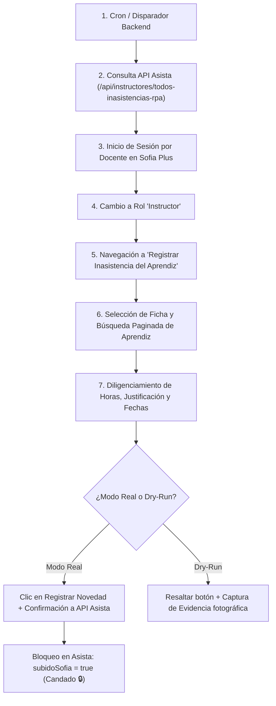

# Módulo RPA Asista: Registro Autónomo de Inasistencias en Sofia Plus 🤖📋

Módulo de **RPA (Robotic Process Automation)** desarrollado en **Node.js** con **Playwright** integrado al ecosistema de Asista para automatizar el reporte oficial de fallas y novedades de aprendices en la plataforma **SENA Sofia Plus**.

---

## 🎯 Objetivo Único

Automatizar el reporte de inasistencias (Falta, Tardanza, Excusada) directamente en el formulario JSF oficial de Sofia Plus (`Gestión de Tiempos -> Registrar Inasistencia del Aprendiz`) utilizando las credenciales seguras del instructor asignado a cada ficha.

---

## 📁 Estructura del Módulo

```text
rpa/
├── bot_inasistencias_sofia.js  # Robot orquestador autónomo de inasistencias en Sofia Plus
├── package.json                # Dependencias (playwright, dotenv) y scripts de ejecución
├── .env.example                # Plantilla de variables de entorno (API_BASE_URL, etc.)
├── .gitignore                  # Exclusión de evidencias de pantalla y archivos temporales
└── README.md                   # Documentación técnica del módulo
```

---

## 🔄 Flujo de Automatización



---

## 🛡️ Reglas de Seguridad y Resiliencia

1. **Modo Seguro por Defecto (Dry-Run):**  
   Si se ejecuta sin `--confirmar-registro` (o con `RPA_DRY_RUN=true`), el robot llena todos los campos, resalta el botón en verde y toma captura de evidencia fotográfica, pero **no** persiste cambios reales.
2. **Protección Anti-Bloqueo de Instructores:**  
   Si un docente tiene credenciales inválidas o expiradas en Sofia Plus, el bot aborta inmediatamente ese docente (sin reintentos ciegos) para evitar el bloqueo de su cuenta SENA por intentos fallidos, y continúa con el siguiente docente.
3. **Manejo de Caídas de Sofia Plus (Rate Limiter):**  
   Si el portal devuelve errores HTTP 500/502/503/504, el robot realiza una pausa dinámica de 5 minutos con cuenta regresiva antes de reintentar.
4. **Pausa Humana:**  
   Pausas aleatorias entre aprendices (3 a 5 segundos) y entre instructores (5 segundos) para no saturar los servidores del SENA.

---

## 🚀 Modos de Ejecución

### 1. Desde el Cron de Asista (Desatendido / Automático)
El cron semanal nocturno de Asista (`backend/services/cronService.js`) invoca automáticamente el servicio `backend/services/rpaService.js` en modo desatendido (`--batch --auto --headless`).

### 2. Desde la Línea de Comandos (CLI)

```powershell
# Ejecutar todas las inasistencias en modo seguro (dry-run)
npm run rpa:inasistencias

# Ejecutar por consola para un instructor específico
node rpa/bot_inasistencias_sofia.js --doc 1098765432

# Ejecutar en modo real desatendido (producción)
node rpa/bot_inasistencias_sofia.js --batch --auto --confirmar-registro --headless
```
