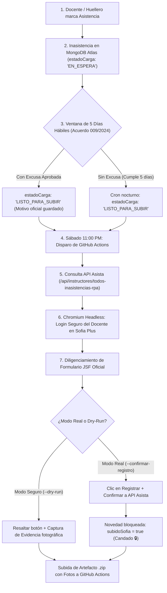

# Módulo RPA Asista: Registro Autónomo de Inasistencias en Sofia Plus 🤖📋

Módulo de **RPA (Robotic Process Automation)** desarrollado en **Node.js** con **Playwright** integrado al ecosistema de Asista para automatizar el reporte oficial de fallas y novedades de aprendices en la plataforma **SENA Sofia Plus**.

---

## 🎯 Objetivo Único

Automatizar el reporte de inasistencias (**Falta**, **Tardanza**, **Excusada**) directamente en el formulario JSF oficial de Sofia Plus (`Gestión de Tiempos -> Registrar Inasistencia del Aprendiz`) utilizando las credenciales seguras del instructor asignado a cada ficha formativa.

---

## 📁 Estructura del Módulo

```text
rpa/
├── bot_inasistencias_sofia.js  # Robot orquestador autónomo de inasistencias en Sofia Plus
├── bot_sofia_login.js          # Asistente de validación y prueba de login individual
├── package.json                # Dependencias (playwright, dotenv) y scripts de ejecución
├── .env.example                # Plantilla de variables de entorno (API_BASE_URL, RPA_API_KEY)
├── .gitignore                  # Exclusión de evidencias de pantalla y archivos temporales
├── descargas/                  # Evidencias fotográficas generadas en cada ejecución
│   └── evidencias_inasistencias/
└── README.md                   # Documentación técnica del módulo
```

---

## 🔄 Flujo de Sincronización en Producción



---

## 🛡️ Reglas de Seguridad y Resiliencia

1. **Modo Seguro por Defecto (Dry-Run):**  
   Si se ejecuta sin `--confirmar-registro` (o con `RPA_DRY_RUN=true`), el robot llena todos los campos, resalta el botón en verde y toma captura de evidencia fotográfica, pero **no** persiste cambios reales.
2. **Protección Anti-Bloqueo de Instructores:**  
   Si un docente tiene credenciales inválidas o expiradas en Sofia Plus, el bot aborta inmediatamente ese docente (sin reintentos ciegos) para evitar el bloqueo de su cuenta SENA por intentos fallidos, y continúa con el siguiente docente.
3. **Manejo de Caídas de Sofia Plus (Rate Limiter):**  
   Si el portal devuelve errores HTTP 500/502/503/504, el robot realiza una pausa dinámica de 5 minutos con cuenta regresiva antes de reintentar.
4. **Pausa Humana:**  
   Pausas aleatorias entre aprendices (3 a 5 segundos) y entre instructores (5 segundos) para no saturar los servidores del SENA.
5. **Aislamiento de Memoria en Linux / Docker:**  
   El navegador Chromium corre con banderas de contención (`--no-sandbox`, `--disable-dev-shm-usage`, `--disable-gpu`) para garantizar ejecución fluida en entornos contenerizados o en la nube sin agotar memoria compartida.

---

## 🚀 Modos de Ejecución

### 1. En la Nube vía GitHub Actions (Recomendado para Producción)

El flujo [`.github/workflows/rpa-sabado.yml`](../.github/workflows/rpa-sabado.yml) gestiona la ejecución autónoma en máquinas virtuales con 7 GB de RAM sin recargar el servidor web de Render:

* **Automático:** Se activa todos los **sábados a las 11:00 p.m. hora Colombia** (`cron: '0 4 * * 0'`).
* **Bajo Demanda:** Desde la pestaña **Actions** en GitHub, selecciona *RPA Sofia Plus - Sincronización de Inasistencias* y pulsa **Run workflow**:
  * **Modo:** `dry-run` (Modo Seguro con capturas) o `confirmar` (Modo Real con persistencia).
  * **Docente (opcional):** Filtrar por documento de identidad de un docente específico.
  * **Límite (opcional):** Procesar un número acotado de novedades (ej. 2 para pruebas rápidas).
* **Artefactos:** Al finalizar, descarga el archivo `evidencias-sofia-plus-<run_id>.zip` desde la sección *Artifacts* de la ejecución para auditar las capturas de pantalla de Sofia Plus.

#### Secrets Requeridos en GitHub:
Configura en **Settings -> Secrets and variables -> Actions**:
* `API_BASE_URL`: URL pública de la API de Asista (ej: `https://tu-app.onrender.com`).
* `RPA_API_KEY`: Clave secreta compartida con el backend para autorizar al robot.

---

### 2. Desde el Cron Interno del Backend (Servidor Local / Dedicado)

El cron semanal nocturno de Asista (`backend/services/cronService.js`) invoca automáticamente el servicio `backend/services/rpaService.js` en modo desatendido (`--batch --auto --headless`).

---

### 3. Desde la Línea de Comandos (CLI)

```powershell
# Ejecutar todas las inasistencias en modo seguro (dry-run)
npm run rpa:inasistencias

# Ejecutar por consola para un instructor específico
node rpa/bot_inasistencias_sofia.js --doc 1098765432

# Ejecutar en modo real desatendido (producción)
node rpa/bot_inasistencias_sofia.js --batch --auto --confirmar-registro --headless
```

---

## 🔑 Autenticación del Robot frente a la API (RPA_API_KEY)

Los endpoints de Asista que consume el robot (`/api/instructores/todos-inasistencias-rpa`, `/api/instructores/documento/:documento/inasistencias-rpa` y `/api/instructores/confirmar-subida-sofia`) requieren autenticación mediante la cabecera `x-rpa-key`, la cual debe coincidir con `RPA_API_KEY` en el `.env` del backend.

Genera una clave criptográficamente segura con:

```powershell
node -e "console.log(require('crypto').randomBytes(48).toString('hex'))"
```
